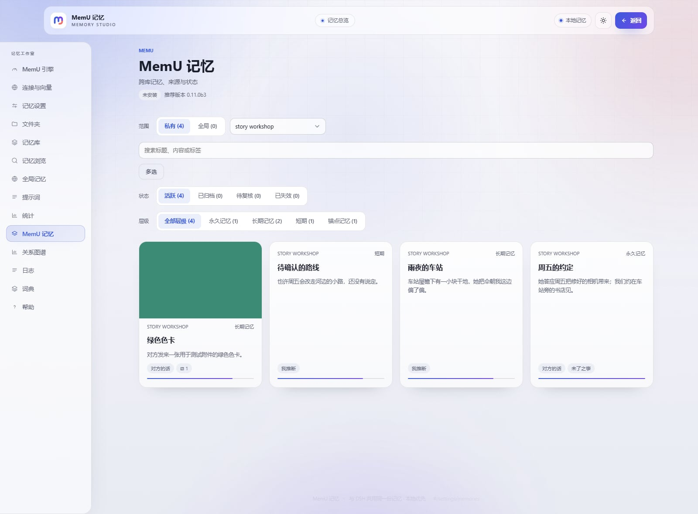
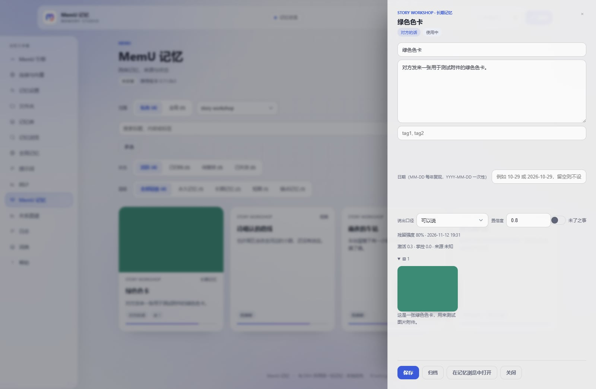
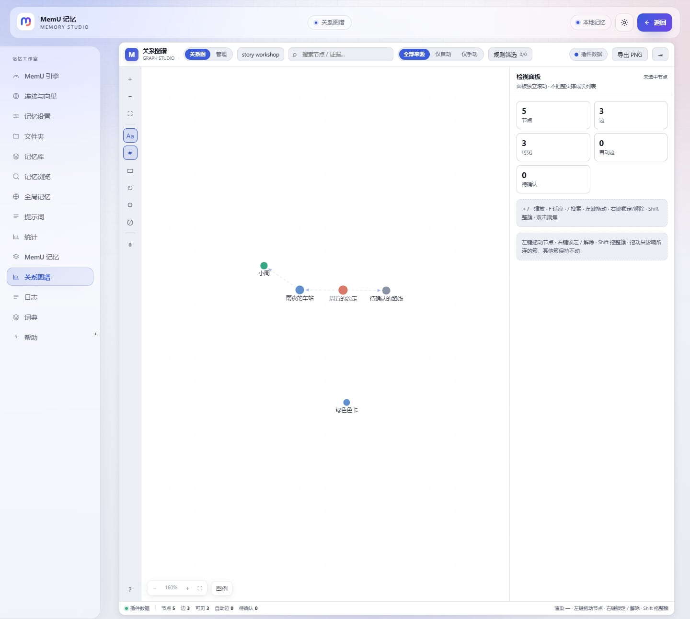
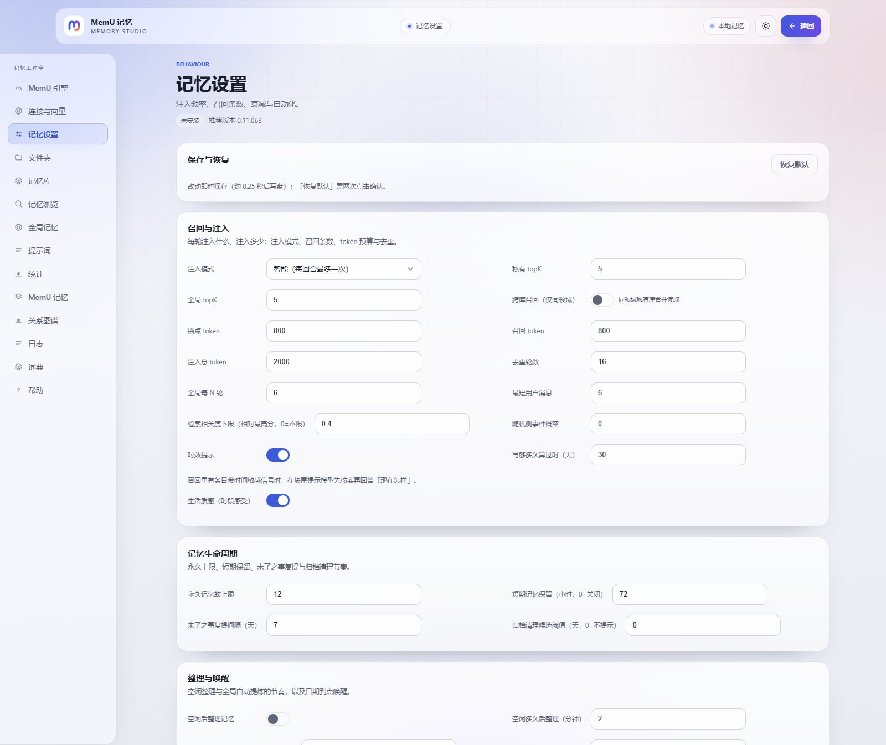
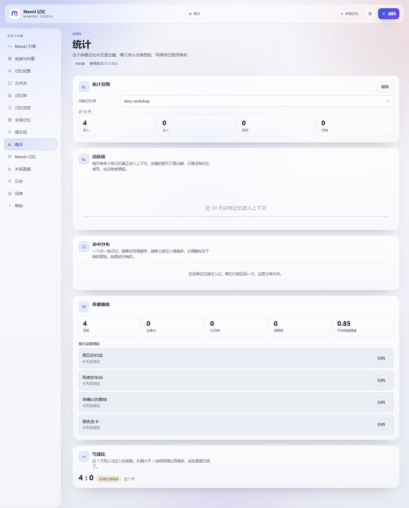
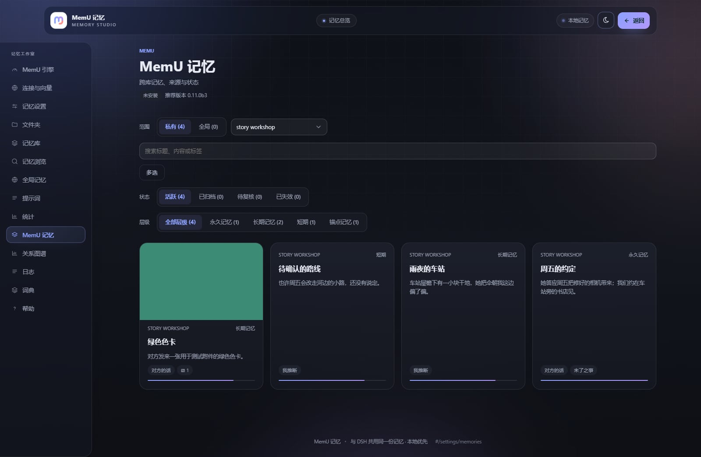
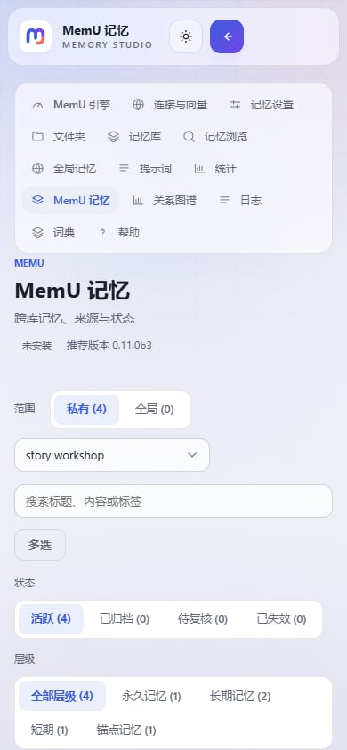

<p align="center">
  
</p>

<h1 align="center">dsh-memu-memory</h1>

<p align="center">
  A local-first memory plugin for <b>DeepSeek Harness</b> — shared by folder, bound to a chat,
  written by the agent, curated in the background, and honest about what it does not know.
</p>

<p align="center">
  <a href="https://www.npmjs.com/package/dsh-memu-memory"></a>
  <a href="https://www.npmjs.com/package/dsh-memu-memory"></a>
  <a href="LICENSE"></a>
  <a href="package.json">=0.2.0-rc.1" src="https://img.shields.io/badge/DSH-%E2%89%A50.2.0--rc.1-4d6bfe"></a>
  <a href="package.json">=20.9" src="https://img.shields.io/badge/Node-%E2%89%A520.9-4d6bfe"></a>
</p>

<p align="center">
  English | <a href="README.zh.md">中文</a>
</p>

---

`dsh-memu-memory` is built for long-form RP and companion chats. It gives a DSH conversation a memory that behaves like memory instead of a log: three retention layers that fade, a first-turn anchor plus at most one per-turn recall, provenance that cannot be quietly upgraded from "I inferred it" to "they said it", contradictions that either wait for a decision or — when explicitly versioned — stay side by side with a conflict card instead of being silently merged, near-identical facts collapse to one entry and one recall seat, and an optional relationship graph with evidence. Speakers, characters, worlds and story branches form hard boundaries, and what a character is allowed to know stays separate from what actually happened.

It is **local-first by default**. The default `agent` backend stores full text in JSON indexes and recalls lexically — no Python, no embedding service, no API key. The `api` backend switches recall to the optional, pinned MemU engine (vector search). MemU is a plugin for people who want it, not a requirement for the plugin to start.

> [!WARNING]
> **Early-stage software.** This plugin is still early and may contain unforeseen errors, bugs or breaking changes. Back up your data, and please [report an issue](https://github.com/Tkingxiao/dsh-memu-memory/issues) or send a pull request — feedback helps the project improve.

> **Status:** 1.3.5. The first public release was 1.0.0. The manual now lives in [`docs/`](docs/), with [`AGENTS.md`](AGENTS.md) as a short index. Back up `~/.dsh/dsh-memu-memory` before upgrades, and read [Compatibility & limits](#compatibility--limits) before storing data you cannot re-create.

## Screenshots

All screenshots are the real WebUI on isolated example data, not anyone's memories.

<table>
  <tr>
    <td align="center"><br/><em>MemU WebUI · cross-library memory wall</em></td>
    <td align="center"><br/><em>Edit, archive or restore without leaving the wall</em></td>
  </tr>
  <tr>
    <td align="center"><br/><em>Full-screen relationship graph · canvas and inspector</em></td>
    <td align="center"><br/><em>Injection, budgets, retention and automation</em></td>
  </tr>
  <tr>
    <td align="center"><br/><em>Daily activity, hit distribution and archive candidates</em></td>
    <td align="center"><br/><em>Dark theme · the same surfaces and motion</em></td>
  </tr>
  <tr>
    <td align="center" colspan="2"><br/><em>Narrow layout · the rail folds into a horizontal strip</em></td>
  </tr>
</table>

## What it remembers

- **Three layers, one timeline.** `short_term` drafts expire after 72 hours by default; `long_term` is the body of ordinary memory; `must_remember` needs a reason and a source, decays over 365 days with a 0.35 strength floor, and can be *marginalized* but never auto-deleted to make room.
- **Recall is a moment, not a dump.** The first turn after a session starts (or after compaction) gets an anchor block with budgets for pinned, core and global memory. After that, each user turn gets at most one recall. Deduplication and a token budget are enforced in code, not left to the prompt. Anchor and recall entries are **title cards**: title, id and semantic tags only. The body stays in the drawer and behind `memu_private_recall` / `memu_global_recall`, so the same budget exposes far more memories without pasting text the model never asked for.
- **A private lexicon writes itself.** The consolidation worker extracts stable, evidenced slang, memes and project terms with one term per entry. Ordinary entries become active immediately (no human review queue), while sensitive triggers and sensitive edits stay user-only. The lexicon page is a card flow with active/archived tabs, edit, archive/restore and two-step permanent delete. A **global lexicon** sits beside the per-library ones: every conversation reads it, only you write it. With same-domain cross-library recall on, the anchor, this-turn match and `memu_lexicon_search` merge those libraries too — the page still browses one book at a time.
- **Private links come from assertions, not statistics.** `autoLinkMode` defaults to *candidates only*: a local zero-token pass ranks names into a review queue and writes nothing. Once you confirm an entity, its names and aliases are matched against memory text (`entity-mention`); `conflicts_with` / `supersedes` / the same `fact_key` add field-evidence edges. Lexical similarity, shared tokens and vectors never create an edge. Confirming, renaming, merging or deleting an entity maintains its edges immediately, and a removed auto edge is suppressed so it cannot come back. Links are metadata, shown with an “Auto” badge in the graph; they never rewrite a body, write a vector or delete anything. Existing libraries migrate with `node scripts/rebuild-auto-links.mjs` (dry-run first, `--apply` takes a backup).
- **A date is either an anniversary or one day.** `MM-DD` recurs every year (a birthday); `YYYY-MM-DD` fires the day before and the day itself, then is spent. Relative wording (今天 / 明天 / 下周X / 月底) is resolved against the turn's scene time and stored as an absolute date; a memory that says "tomorrow" is stored as the dated form, so an appointment does not come back every year.
- **Memory fades unevenly.** Recency, access count, peak and end effects, primacy, habituation and flashbulb accuracy feed one strength score. Mood is described by four components (joy / anger / sorrow / fear, summing to 1) plus arousal (intensity) and dominance (sense of control); a compound mood such as jealousy is a named mix of the four, not a new axis. Mood only reorders recall: it never enters the injected text and never rewrites a memory body. Gating is the OR of three independent conditions — the dominant share is >= 0.35, |arousal - 0.35| >= 0.1, or |dominance| >= 0.25; when none holds, both multipliers are exactly 1. Older entries carry no emotion and keep the old valence path; the four axes are never inferred back from valence. A vivid memory can be more confident than it is accurate, and the UI says so.
- **Provenance is a fact, not a style.** Every entry carries `source` / `source_kind` (`user_said` / `assistant_said` / `told` / `imagined` / `inferred` / `tool`), `speaker_id`, `confidence`, `accuracy`, and disclosure rules. A vague recollection cannot impersonate a quote, and the assistant's own promises or plans cannot be filed as something the user said.
- **Contradictions do not get silently merged.** An ordinary contradiction still lands as `pending_review`: it is not injected, not recalled, and appears in a review queue until someone accepts or rejects it. When the writer explicitly marks two statements as versions of one fact (`conflicts_with`), both stay active, are recalled together and surface as a conflict card; an explicit `supersedes` retires the old row without deleting its text.
- **Secrets stay excluded.** `secret` visibility, group-chat channels, characters, worlds, branches and `knownBy` all constrain reads and edits. Automatic recall never injects a `secret` memory, and a `secret` is still readable by an explicit recall from the same folder — it hides a memory from the prompt, it is not a lock. What actually separates two conversations in one folder is the `context` scope (`channelId` / `characterId` / `worldId` / `branchId`); a blank scope on both sides means one shared scope, which is the point of a folder. The old `visibility: 'session'` level is gone — reading turns it into `shared` with its `context` untouched, and `node scripts/migrate-visibility.mjs` rewrites libraries that still store it (`--apply`, backs up first).
- **People and stories are structured.** Group chat uses stable `speakerId` / `channelId`, not display names. RP uses `characterId` / `worldId` / `branchId`. Relationships are edges with a note and confidence, entities can be renamed without rewriting memory bodies, and the current relationship state (familiarity, trust, warmth, boundaries, promises) is a snapshot that keeps its history and evidence.
- **Images are pointers and captions, not pretend vision.** Attachments are deduplicated by SHA-256, quota-limited and tiered; an image without a description is remembered as "received an image", never as a scene the model did not see.
- **Housekeeping happens in the background.** Consolidation runs in a seeded fork sub-session, never as an editable turn in your chat. Failed runs back off instead of reporting success.

### Active memory, measured

Idle consolidation is not "every quiet session gets a fork". Before a fork the plugin scores the evidence since the last cursor: human turns (`H`), content volume (`C`: human text, assistant text and deduped successful tool results, 2,000 characters per result) and effective tool work units (`U`), with `score = 0.35*min(H/3,2) + 0.45*min(C/4000,2) + 0.20*min(U/20,2)` (default threshold 0.8). A session idle for 15 minutes wakes below that score only when it is small; transcripts of 2,000+ events must earn their fork, because the host seeds the full prefix. A recent consolidation or a recent recall suppresses the idle fork.

More is not better: thin turns on a large transcript are skipped by the guard (about 37% fewer prompt tokens on the same scenarios, at the cost of roughly 1 in 22 labels arriving a little later), but once the unconsolidated range passes 600 events the check runs unconditionally, so decisions made early in a long session do not stay out of memory forever.

Four real long sessions from this machine were replayed read-only (no new chat) and their turns were counted:

| Session | Events | Turns | Score-qualified | Below threshold | Fresh human turns after cursor |
|---|---:|---:|---:|---:|---:|
| `62056bff…` | 5,913 | 12 | 6 | 6 | 0 |
| `adedb9ac…` | 5,766 | 23 | 16 | 7 | 0 |
| `e38a0de0…` | 85 | 2 | 0 | 2 | 0 |
| `edf7dc5c…` | 78 | 4 | 0 | 4 | 0 |

Below-threshold turns on the two small sessions can still wake through starvation; on the 2,000+ event sessions they do not. None of the four had new human input after its real cursor, so none would fork again immediately.

## One WebUI

The sidebar has exactly **one** entry: **MemU WebUI**. The memory wall and all settings live in the same navigation, with deep links such as `#/settings/memories`, `#/settings/folders` and `#/settings/stats`. The interface follows the browser locale (Chinese or English).

**Private / global groups with multi-select.** The "Memories" page splits into **Private** and **Global** blocks (private first, default). The private block supports **multi-select**: bulk archive, restore and permanent delete (two-step confirm) — one failed row never eats the rest. Every row on the Global memory page has a "View" action that jumps straight to that entry on the wall.

**In-place work.** Clicking a memory card opens a right-side drawer with the full text and the fields that decide how it behaves — title, content, tags, disclosure, confidence, open loop — plus save, archive, restore and "open in the browser" for heavier work. Archived memories can be deleted in the same drawer; the first click only arms it and the second confirms. Global memories are read-only in the drawer and link to their own page. Filters and scroll position stay where they were. Cards that carry images use the first usable attachment as a cover, and the drawer opens the full gallery; `secret` and `never_say` entries never receive a pixel URL, so they show a label instead.

**One page for the graph.** **Relations** is its own full-screen page in the WebUI (`#/settings/graph`): the canvas on the left, the inspector on the right, and a **Manage** tab for the list view with the same filters. Source (all / automatic only / manual only), rule, library and search all narrow one shared dataset instead of switching modes, and Settings → Relations is a single button that opens that page. The scope selector still carries a **Global memory** entry: nodes are global entries and edges are `related/refines/supports`; the global view is read-only, and edges are removed from the global memory list.

The graph runs on a **self-written continuous force engine** — no third-party runtime is bundled. It stays alive while you work, preserves node positions and the camera across background data refreshes, and stops requesting frames the moment it cools down, so an open graph costs no idle GPU. Dragging pins a node exactly where you drop it (release never yanks it back), and only the cluster you touched keeps simulating: frozen clusters act as obstacles the moving one cannot slide through. Repulsion, link distance and centering are adjustable in the panel, labels avoid collisions, and the minimap repaints only after the canvas does. Zoomed all the way out the nodes necessarily merge on screen — separation lives in world coordinates, so spread clusters with repulsion/link distance instead of the zoom. Settings → Relations is a single button that opens the full-screen graph page in the WebUI, where you can also add, edit and delete nodes, and filter edges by the rule that produced them. The layout only visualizes recorded links: it never infers or writes relationships. The graph page also lists **entity merge candidates** (same kind, contained or near-identical spellings) — suggestions only, confirmed by two clicks, and merging redirects links and folds aliases into the main node without deleting any memory.

| Page | What it is for |
|---|---|
| Memories | Private/global grouped wall, source/status/library/preview, in-place drawer, multi-select bulk ops, node graph tab |
| Engine & connection | Optional MemU engine install/switch, embedding endpoint, backups and restore; local runtime download shows MB/s, offers npmjs / npmmirror, and supports pause, stop and resume |
| Memory settings | Injection mode, token budgets, topK, same-domain cross-library recall, relevance threshold, retention, open-loop cadence, freshness hint, date wake-up, automation |
| Folders | Folder-level private/global ceiling, expandable conversations and their own switches |
| Libraries | Create, rename, archive, restore, explicitly delete libraries |
| Memory browser | Full-text editing, attachments, review queue, graph and bounded canvas, JSON/ZIP import/export |
| Global memory | Domain-scoped global memories, evidence, review queue and the separate curator; every row can jump to the wall |
| Prompts | General / RP / Coding / Mixed variants, overrides and per-key reset; new conversations start on RP and can pick a domain in the first-run prompt |
| Stats | Daily activity, hit distribution, health, never-recalled shortlist, 7-day write/read ratio |

Settings save as you change them (250 ms debounce), with about 2.5 s cross-window sync and a heartbeat for writes made by tools or another window. The WebUI opens in a new tab; when a popup is blocked it falls back to an in-app overlay without unloading the host SPA. Light, dark, reduced-motion and narrow layouts are supported.

### Injection token budgets

`anchorTokens` and `turnTokens` bound anchor and recall content independently (default 800 each). `injectionTotalTokens` caps the whole plugin message (default 2000); it does not replace the recall budget. Title cards spend far fewer tokens per entry than full text, so the same budget exposes more memories; the budget itself was deliberately not increased in 1.2.2.

### Time-sensitive memory (1.2.3)

- **Stale recall says so.** When recalled entries carry a time signal (a one-off date already in the past, wording like "latest / current / price / version", or an entry older than `freshnessDays`), one conditional line is appended after the recall block telling the model to verify with a search tool *if the conversation has one*. It never claims a tool exists, and it is dropped rather than pushing recall over budget.
- **Dated promises keep asking.** An `open_loop` memory whose `YYYY-MM-DD` has passed is re-raised every `openLoopRemindDays` (default 7) with its date and how late it is — undated promises keep the old "quiet after one mention" behaviour. Closing a loop is always the user's action.
- **Optional wake-up call.** `salientWake` (default **off**) schedules a one-shot host task per bound conversation so a salient date is spoken about on the day, even if the conversation went cold. The delivered turn carries its own text — recall and anniversary blocks do not run there — and the tasks are visible in the host's schedule UI. Requires the host process to be running; experimental until verified on a real install.

### Domain Prompts

Resident guidance, writing policies and consolidation prompts follow the current session domain. Local tools and remote JSON consolidation share the domain body, with separate supported output contracts. New conversations default to RP; Coding, Mixed and custom pages stay enabled and can be selected per conversation. The new-conversation memory prompt also offers the four memory domains, so a coding session can be started in an RP workspace without remembering to change the sidebar afterwards.

| Domain | Memory focus |
|---|---|
| Coding | Requirements, acceptance criteria, interfaces, call chains, invariants, root causes, tradeoffs, verification and handoff points. Neutral engineering notes, not character psychology. Preserve necessary minimal code and exact semantics without copying whole files or truncating critical conditions. |
| RP | Evidenced moments, character reactions, names and habits, commitments, boundaries and repair. Let memory shape present choices without repetitive callbacks, invented facts or automatic intimacy. |
| Mixed | The prompt separates technical, character and OOC material per item; it does not automatically change the session domain. Tags aid retrieval, not access control or character knowledge. |
| General | Neutral facts, preferences, decisions with reasons, promises and constraints; no default roleplay. |

Updated defaults never overwrite custom text. The default-update notice remains until that prompt is saved or reset. Compare, merge or restore individual prompts in **Prompts**; there is no need to clear memories. Regression tests cover routing and output contracts, not a guarantee of naturalness or long-term memory quality, which still requires real-conversation evaluation.

## Installation

### Requirements

| | |
|---|---|
| DSH | `>=0.2.0-rc.1` (web profile; verified on `0.2.2-rc.1`, 2026-11-05) |
| Node.js | `>=20.9` |
| OS | Windows, macOS or Linux, wherever DSH's web host runs |
| Optional engine | Python 3.11+ **only** if you choose the vector backend. The default backend needs no Python, no embedding service and no API key. |

### Method 1 — npm (recommended)

```sh
dsh plugin --profile web add dsh-memu-memory
dsh web
```

Restart the host after installing or updating. The plugin appears as **Settings → MemU**, and the right sidebar gets the **MemU WebUI** button.

> Replace `web` with your profile name if you use another one. Older DSH CLIs accept the shorter form `dsh plugin add dsh-memu-memory` without the profile flag.

### Method 2 — npx (no global install)

```sh
npx @deepseek-ai/dsh plugin --profile web add dsh-memu-memory
npx @deepseek-ai/dsh web
```

### Method 3 — from a local checkout (development)

The repository has **no build step**: `lib/` is the runtime. Clone it, link the checkout into your DSH profile, and add the bundle.

```sh
git clone <this repository> dsh-memu-memory
cd dsh-memu-memory
npm ci --legacy-peer-deps
```

In the profile's `package.json`:

```json
{
  "dependencies": {
    "dsh-memu-memory": "link:/absolute/path/to/dsh-memu-memory"
  },
  "dsh": {
    "profile": {
      "bundles": ["dsh-memu-memory"]
    }
  }
}
```

Then restart DSH. A symlinked checkout is picked up on restart; there is no bundle cache.

### Optional — vector engine (MemU)

The default `agent` backend is fully usable without this step. Install the engine from **Settings → MemU → Engine & connection**, or from a terminal:

```sh
npx --package dsh-memu-memory dsh-memu-memory-setup
```

What it does:

- installs the pinned `memu-cli==0.11.0b3` into `~/.dsh/dsh-memu-memory/engine/<version>/venv`;
- never installs into the system Python or user site-packages, and leaves no `pip` inside the venv;
- tries PyPI mirrors in order (user-configured → Tsinghua → Aliyun → pypi.org);
- if no usable Python/pip exists, uses a **pinned uv** runtime inside the plugin directory and leaves the system `PATH` untouched;
- downloads roughly 150 MB, runs a real smoke test, and keeps the previous version for rollback.

The default `memoryBackend="agent"` uses lexical recall and does not call an embedding service. To enable the vector library, choose `memoryBackend="api"`, then select `vectorSource="local"` for managed local embeddings or `vectorSource="api"` for a configured compatible embedding endpoint (which may itself run on localhost). Both sources feed MemU storage and retrieval; installing the MemU engine alone does not enable vectors.

`memoryMode` (`local` / `cloud`) is a MemU storage-compatibility setting, not the embedding switch or source selector; its cloud option is not a claim that managed local inference is offline cloud storage. Summary generation is configured independently of the vector route: ordinary private consolidation uses an Agent fork; an explicit remote-summary action uses its chat endpoint and commits through the same memory write path. Recall uses neither LLM reranking nor an LLM fallback. Exact memory ids still use the direct path; the plugin does not maintain a parallel vector database.

Managed model download, progress reporting and profile-switch/migration flows are implemented, but real model/runtime downloads and end-to-end native inference/switching have not been verified in this work. A candidate or `pending` artifact is not available for use; it must not be advertised as downloadable or ready until its artifact and validation gates pass.

## First run

1. Install, then restart DSH.
2. Open **MemU WebUI** from the sidebar (or Settings → MemU).
3. New conversations ask once whether this chat should use memory: private only, global only, both, or none. **Remember my choice** skips the question later. The card you pick **sets both switches at once**, so the sidebar shows the card you chose; the advanced "existing / new library" pick only changes which library the private layer reads, never the two switches.
4. If you want a folder-wide ceiling, set it under **文件夹** — a folder can forbid private or global memory, and the chat switches will respect that ceiling.
5. Talk. The agent writes private memories itself. The **MemU 记忆** wall is where you review, edit, archive, link and export them.

Folder policy is a **ceiling, not an initial value**: turning a folder switch off immediately clamps every conversation in it, and turning it back on restores each conversation's own choice. A folder with both switches off does not prompt, does not create a library and does not inject anything.

## Model tools

| Tool | Purpose |
|---|---|
| `memu_private_remember` | Write a private memory, with source, layer, disclosure, visibility, tags, open loop and attachment references |
| `memu_private_recall` | Natural-language or exact-id recall; results may carry up to two relationship pointers |
| `memu_private_list` | List the memories usable in the current scope |
| `memu_private_update` | Edit, without bypassing pin admission, review or visibility rules |
| `memu_private_archive` | Archive; never delete |
| `memu_private_unpin` | Marginalize a permanent memory with a first-person reason, quota and cooldown |
| `memu_private_link` | Link memories/entities with evidence, or update a relationship snapshot; also adjudicates uncertain `memu_private_link_suggest` candidates; cannot delete edges |
| `memu_private_link_suggest` | Refresh deterministic edges (confirmed-entity mentions and field evidence) for ids written this consolidation and return only uncertain candidate pairs |
| `memu_lexicon_search` | Search active lexicon terms this conversation can see: bound library + global lexicon (+ same-domain libraries when cross-library recall is on); archived and tombstoned terms stay hidden |
| `memu_lexicon_propose` | Add or update a lexicon term in the bound library (never the global lexicon); ordinary entries become active immediately, sensitive triggers remain user-only |
| `memu_global_recall` / `memu_global_list` | Read the global layer by domain |
| `memu_status` | Storage health, sync heartbeat, recall state and image-turn status |

The main agent has **no global write tool**. Global memories are produced only by the separate curator.

## Privacy, permissions & data

**What is stored.** Everything lives under `~/.dsh/dsh-memu-memory/` (or `$DSH_MEMU_MEMORY_HOME`; the legacy `$DSH_MEMU_HOME` and `~/.dsh/dsh-memu` are still honoured when no new `state.json` exists):

```text
~/.dsh/dsh-memu-memory/
├─ state.json                 settings, folder policies, session bindings
├─ index/<libraryId>.json     private memory bodies (source of truth)
├─ index/global.json          global memories
├─ index/*.stats.json         per-day counters (90-day roll)
├─ index/*.media.json         attachment metadata and reference counts
├─ index/*.entities.json      entities and relationship snapshots
├─ attachments/<libId>/<sha256>.<ext>
├─ libraries/*.sqlite3        optional vector layer (acceleration, not truth)
├─ engine/<version>/venv      optional MemU engine
├─ prompts/                   user prompt overrides
├─ backups/                   explicit backups and pre-switch snapshots
└─ logs/                      install log only
```

- **Text and images are not encrypted at rest.** The directory is inside your home directory. If that is not acceptable, do not store secrets in memories and protect the disk with OS-level encryption.
- **Images are opt-in privacy data.** Only host-approved attachments are captured. `secret` entries never serve their attachments over the HTTP route; `never_say` captions are not echoed. The vision description service is enabled by default, but it only sends an image after you configure an endpoint, and it may cost money. It never uses host credentials automatically.
- **Network.** No telemetry. Outbound traffic happens only for (a) the optional engine installer downloading Python packages/uv from the configured mirrors, (b) the embedding endpoint you configure, (c) the optional remote summary model, and (d) the vision endpoint you configure (enabled by default; no call is made until an endpoint is configured). The default backend makes no external calls for memory operations.
- **Shell and filesystem.** The optional engine installer uses Python/pip in a private venv (and a pinned uv fallback inside the plugin directory). It does not modify system Python, install global packages or change `PATH`. All memory writes are confined to the data directory; config writes use temp-file + rename.
- **Deletion.** Archiving moves a memory out of retrieval; permanent deletion is a separate, guarded action for already-archived entries. Deleting a conversation only unbinds it; it never deletes the library. Library deletion asks for confirmation and is backed up first.

## External messages in a long tool turn

A host turn may remain open while a third-party tool waits for messages.
New human input can trigger one bounded recall at the next model step without
ending that turn or making another model call. Native user messages work directly.
Unmarked tool logs, sleep completions, failed calls and empty polls do not trigger it.
The plugin does not depend on a particular waiting implementation.

Transport plugins can put this exact object in their own `ToolResult.meta.memoryInbound`:

```js
const batch = {
  type: 'dsh-memu-memory/inbound-batch',
  version: 1,
  producer: 'my-message-transport',
  batchId: 'delivery-42',
  messages: [{
    id: 'remote-message-18',
    role: 'user',
    context: { channelId: 'room-1', speakerId: 'person-7' },
    content: [{ type: 'text', text: 'Where is the deployment script we discussed?' }],
  }],
}
// A normal ToolResult: keep the original model-facing content and other metadata.
return { content: originalContent, meta: { ...originalMeta, memoryInbound: batch } }
```

The channel/character/world/branch must match the conversation's configured memory
scope; omit unavailable identities rather than guessing them. Images must use
`{ type: 'image', attachment: hostAdmittedRef }`, never filesystem paths, URLs or bytes.
If metadata is unavailable, return the complete protocol as JSON text and list
the exact tool name under **External message tool allowlist**. JSON embedded in logs
or code fences is not accepted, nor is JSON from an unapproved tool.

An in-process integration may instead import
`ingestInboundBatch` from `dsh-memu-memory/integration` and call
`ingestInboundBatch({ sessionId, batch, ctx, session })`. It registers work only:
the producer still delivers the actual incoming content to the model. It does not
wake the agent, append a fake user turn or write fact memories.

Deduplication uses producer + channel + speaker + message id; changing a delivery id
does not replay an already processed message. Memory cadence advances by human-message
batches even when the host turn number stays fixed. Pending input is capped at 32
messages / eight images / 96 KB, with at most 4000 characters per external text block;
overflow is explicitly refused, never silently discarded. Split oversized batches.
Recall failure preserves the queue with a 30-second retry delay; cancellation does not consume it.
Only the admitted batch is confirmed, so messages arriving during recall remain pending.
Running agents (including waiting tools) and pending batches are not sleep-consolidated;
the idle window starts from real message activity or the agent's return to idle.
`memu_status` reports `inbound` queue/clock/result and `inbound_error` when degraded.

## Compatibility & limits

- **Host:** DSH `>=0.2.0-rc.1`, using public extension points only (tools, injection, session query, subagents, slots, a prefixed HTTP route). No host source modifications. The core surfaces (13 `memu_*` tools, guide injection, settings page, right-sidebar tab, prefixed RPC) were verified on `0.2.2-rc.1` on 2026-11-05; the check table lives in [`docs/host-adaptation.md`](docs/host-adaptation.md). The optional dated-wake feature uses the host-wide `ctx.schedule` task API introduced in `0.2.2`; on `0.2.0`–`0.2.1` (session-scoped reminders) it detects the older shape and skips with one warning instead of retrying every sweep.
- **Recall quality:** the default backend is lexical. Semantic recall depends on the optional engine and the embedding model you choose; the plugin cannot improve a model it does not own. LongMemEval, long-running group-chat A/B and "human-likeness" scores have **not** been run — test counts are not a quality score.
- **No cloud sync, no accounts, no cross-device sync.** This is a local plugin with no server-side identity.
- **Images without vision:** without an optional caption/vision endpoint, an image memory is a pointer plus what a person wrote about it. The plugin does not claim to see pixels.
- **Poisoned v4 sessions:** historical `format v4 message requires a producer-owned source kind` rows can be diagnosed but not rewritten; the plugin never edits private session files.
- **Agent presets:** a conversation whose preset (`i-am-yuike`, `yuike-standard`, …) carries its own `cordis.yml` composes its model-facing plugins from that list alone, and its scope never delivers `agent/pre-step` to this plugin. At runtime `lib/preset-scope.js` attaches an injection listener to that agent's own context, so **anchor and recall delivery works**. All conversations now receive the memory rules as one `<memory-guide rules="…">` plugin message on the first step of a turn; the plugin no longer registers a system-prompt section, and the message is replaced after a domain/prompt change or a compaction (`rulesKey` / `guideLost`). The **final tool list** is a third, separate question: it follows the preset's own plugin list and the host scope, and it cannot be inferred from whether this plugin is listed — observations in this repo record both "no `memu_*` tools" and `memu_private_*` present in some presets' tool chains. **Per-preset tool availability still needs a real-host check (W3)**; until then do not read this as "presets have no tools", nor as "listing the plugin is enough". The plugin never edits anyone's preset files.
- **Consolidation worker (C 包, 2026-10-30).** An idle or manual pass now works from a *fixed snapshot*: it takes the public `sessionQuery.observeSession()` lease (falling back to `readSession()` when the host offers no lease), cuts at the last complete `turn/end`, and drops unpaired tool calls and half steps — a live transcript whose last turn is still open is **deferred**, never consolidated. A job is settled only by a structured completion receipt that is cross-checked against the library index (an id the library does not contain is not a success, and a rewrite of an existing id counts as an update, not a new memory). Checked / pending / in-flight ranges and a lease are persisted separately in `consolidation.json`, so a crash, a timeout or a failed turn leaves the range pending instead of looking consolidated. **Limits:** the worker still runs inside the parent preset's own system prompt — it receives an explicit "you are a background consolidation worker, not this character" brief, which reduces but does not remove persona carry-over, because the host has no public API to replace that prompt; and when the conversation's tool surface carries no `memu_private_remember` / `memu_private_update` (or exposes memory only through PTC), consolidation reports `unavailable` (`worker-tools-missing` / `worker-tools-ptc-only`) rather than forking a worker that could not write. The parent's library, scope, domain and memory context are re-checked before dispatch, on every worker tool call, and again before any result is credited.
- **"Tomorrow" is resolved at write time.** A relative day (今天 / 明天 / 后天 / today / tomorrow) together with a month-day settles into one dated memory; a memory that only says "sometime next month" keeps no date rather than inventing one. A date that was already written as `MM-DD` is not rewritten — the fix applies to new writes.
- **Not in scope:** cloud MemU integration, source backfill for old entries, automatic repair of already-written v4 corruption.

## Development & verification

```sh
npm ci --legacy-peer-deps
npm test                                  # full suite; the isolated real-engine case skips unless configured
npm run check                             # syntax + i18n key alignment + package.json
npm run build:graph                       # rebuild shipped offline assets after graph source changes
node scripts/acceptance-local.mjs         # 50 automated acceptance checks
node scripts/migrate-visibility.mjs       # report (add --apply to rewrite) libraries that still store the removed session level
node --import ./tests/loader-register.mjs scripts/preview.mjs --port 7789
node scripts/make-readme-shots.mjs        # re-record the screenshots above against that preview
```

The preview serves the real WebUI against isolated example data at `http://127.0.0.1:7789/dsh-memu-memory/ui#/settings/memories`.

With the preview running, use `npm run test:graph-browser -- http://127.0.0.1:7789/dsh-memu-memory/ui#/settings/memories` in another terminal to check 200 nodes, desktop/narrow layouts, dragging, refresh stability, themes and load retries. Run `npx playwright install chromium` once, or set `GRAPH_BROWSER_CHANNEL=msedge` on Windows to use installed Edge. Stress data is intercepted only in the test browser and never written to memory. No CDN is needed at runtime; the bundle carries no third-party runtime code, which `lib/webui/graph-LICENSE.txt` records.

The suite includes two optional real-engine integration cases: curator writing requires `DSH_MEMU_TEST_ENGINE_PYTHON`, and the backup venv/WAL case requires `DSH_MEMU_BACKUP_REAL_ENGINE=1`; both are skipped by default. The 50 automated acceptance checks pass. The optional engine was installed and smoke-tested in an isolated directory with the pinned wheel; embedding tests use a local deterministic server, which proves the protocol, not semantic quality.

## Documentation

- Release notes: [`CHANGELOG.md`](CHANGELOG.md)

[`AGENTS.md`](AGENTS.md) is the index for anyone changing this repo — which file answers
which question. The detail lives in [`docs/`](docs/): failure modes, the change process,
the host facts, and the UI, memory and environment rules.

## License

[MIT](LICENSE) © dsh-memu-memory contributors.

You may use, modify, distribute and sell this software, provided the copyright notice and permission notice are included. The software is provided **as is**, without warranty of any kind.

---

If this plugin is useful to you, open an issue with the host version and a minimal reproduction — memory bugs are easiest to fix when the transcript and the storage state are both available.
