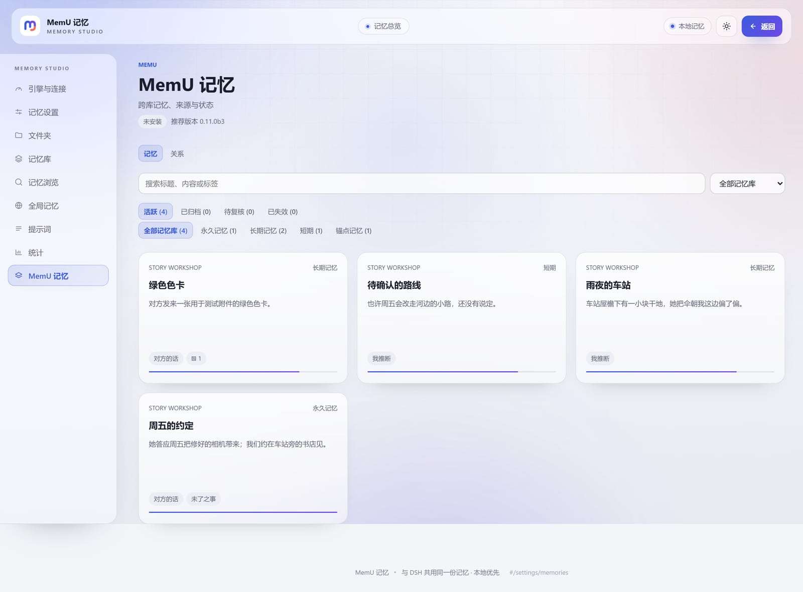
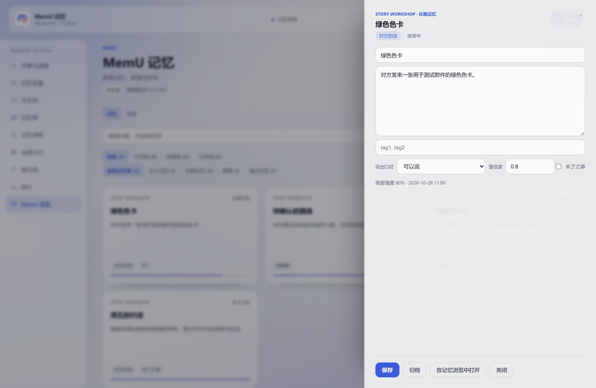
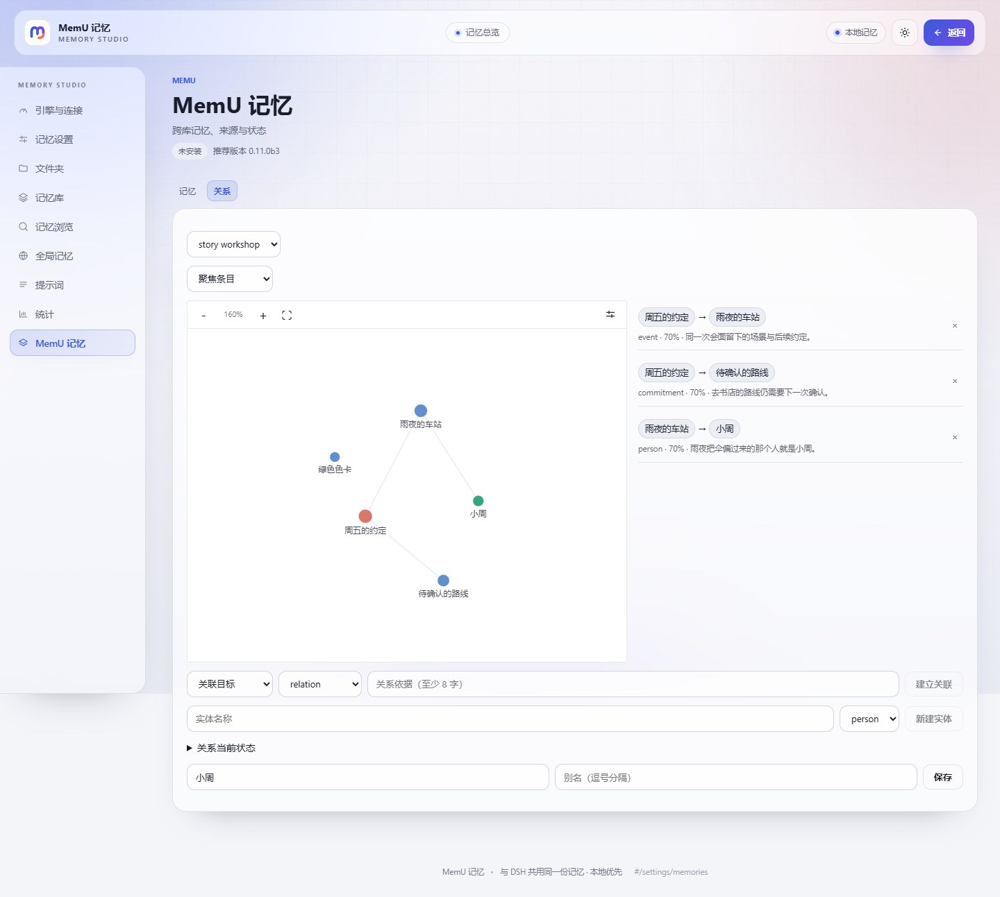
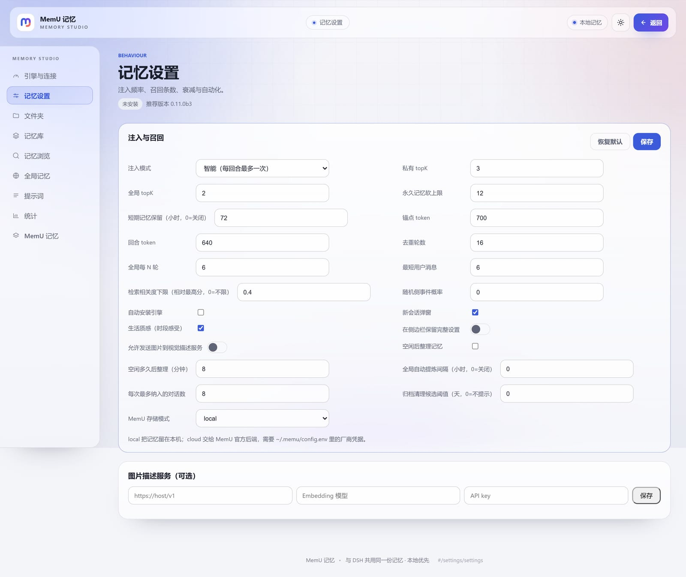
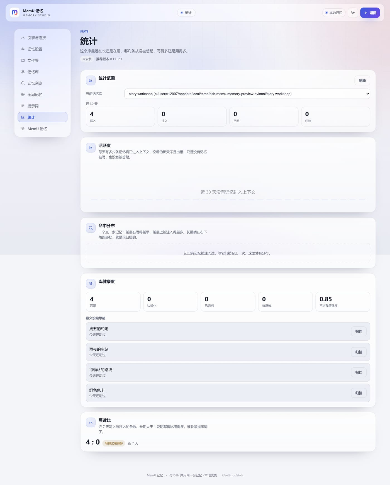
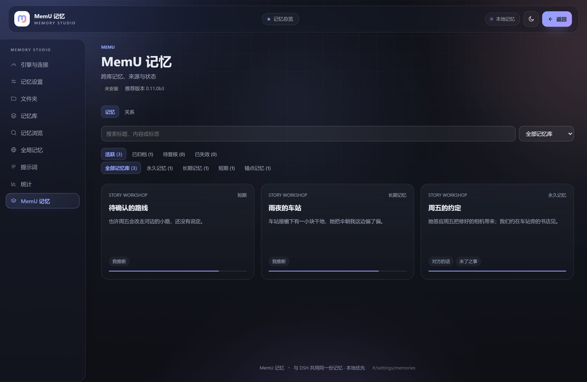
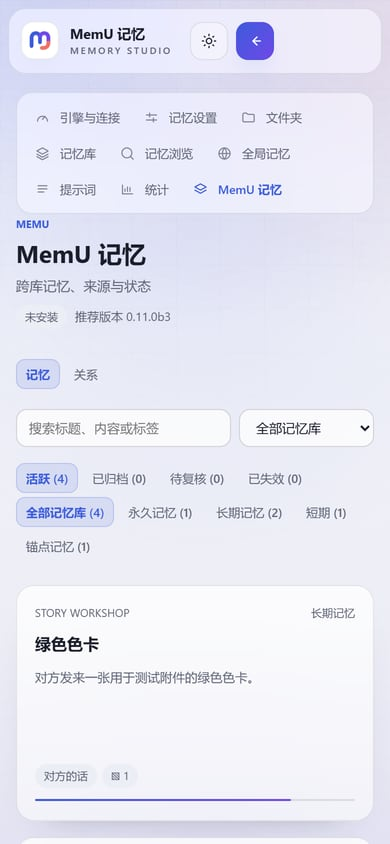

<p align="center">
  
</p>

<h1 align="center">dsh-memu-memory</h1>

<p align="center">
  A local-first memory plugin for <b>DeepSeek Harness</b> — shared by folder, bound to a chat,
  written by the agent, curated in the background, and honest about what it does not know.
</p>

<p align="center">
  <a href="https://www.npmjs.com/package/dsh-memu-memory"></a>
  <a href="https://www.npmjs.com/package/dsh-memu-memory"></a>
  <a href="LICENSE"></a>
  <a href="package.json">=0.2.0-rc.1" src="https://img.shields.io/badge/DSH-%E2%89%A50.2.0--rc.1-4d6bfe"></a>
  <a href="package.json">=20.9" src="https://img.shields.io/badge/Node-%E2%89%A520.9-4d6bfe"></a>
</p>

<p align="center">
  English | <a href="README.zh.md">中文</a>
</p>

---

`dsh-memu-memory` is built for long-form RP and companion chats. It gives a DSH conversation a memory that behaves like memory instead of a log: three retention layers that fade, a first-turn anchor plus at most one per-turn recall, provenance that cannot be quietly upgraded from "I inferred it" to "they said it", contradictions that wait for a decision instead of both being read as true, and an optional relationship graph with evidence. Speakers, characters, worlds and story branches form hard boundaries, and what a character is allowed to know stays separate from what actually happened.

It is **local-first by default**. The default `agent` backend stores full text in JSON indexes and recalls lexically — no Python, no embedding service, no API key. The `api` backend switches recall to the optional, pinned MemU engine (vector search). MemU is a plugin for people who want it, not a requirement for the plugin to start.

> [!WARNING]
> **Early-stage software.** This plugin is still early and may contain unforeseen errors, bugs or breaking changes. Back up your data, and please [report an issue](https://github.com/Tkingxiao/dsh-memu-memory/issues) or send a pull request — feedback helps the project improve.

> **Status:** 1.1.1. The first public release was 1.0.0. The manual now lives in [`docs/`](docs/), with [`AGENTS.md`](AGENTS.md) as a short index. Back up `~/.dsh/dsh-memu-memory` before upgrades, and read [Compatibility & limits](#compatibility--limits) before storing data you cannot re-create.

## Screenshots

All screenshots are the real WebUI on isolated example data, not anyone's memories.

<table>
  <tr>
    <td align="center"><br/><em>MemU WebUI · cross-library memory wall</em></td>
    <td align="center"><br/><em>Edit, archive or restore without leaving the wall</em></td>
  </tr>
  <tr>
    <td align="center"><br/><em>Relationship graph and adjacency list in one view</em></td>
    <td align="center"><br/><em>Injection, budgets, retention and automation</em></td>
  </tr>
  <tr>
    <td align="center"><br/><em>Daily activity, hit distribution and archive candidates</em></td>
    <td align="center"><br/><em>Dark theme · the same surfaces and motion</em></td>
  </tr>
  <tr>
    <td align="center" colspan="2"><br/><em>Narrow layout · the rail folds into a horizontal strip</em></td>
  </tr>
</table>

## What it remembers

- **Three layers, one timeline.** `short_term` drafts expire after 72 hours by default; `long_term` is the body of ordinary memory; `must_remember` needs a reason and a source, decays over 365 days with a 0.35 strength floor, and can be *marginalized* but never auto-deleted to make room.
- **Recall is a moment, not a dump.** The first turn after a session starts (or after compaction) gets an anchor block with budgets for pinned, core and global memory. After that, each user turn gets at most one recall. Deduplication and a token budget are enforced in code, not left to the prompt.
- **A date is either an anniversary or one day.** `MM-DD` recurs every year (a birthday); `YYYY-MM-DD` fires the day before and the day itself, then is spent. A memory that says "tomorrow" is stored as the dated form, so an appointment does not come back every year.
- **Memory fades unevenly.** Recency, access count, arousal, mood congruence, peak and end effects, primacy, habituation and flashbulb accuracy all feed one strength score. A vivid memory can be more confident than it is accurate, and the UI says so.
- **Provenance is a fact, not a style.** Every entry carries `source` (`user_said` / `inferred` / `imagined` / `told`), `confidence`, `accuracy`, and disclosure rules. A vague recollection cannot impersonate a quote.
- **Contradictions wait.** A write that rewrites or contradicts an existing entry lands as `pending_review`: it is not injected, not recalled, and appears in a review queue until someone accepts or rejects it.
- **Secrets stay excluded.** `secret` visibility, group-chat channels, characters, worlds, branches and `knownBy` all constrain reads and edits. Automatic recall never injects a `secret` memory, and a `secret` is still readable by an explicit recall from the same folder — it hides a memory from the prompt, it is not a lock. What actually separates two conversations in one folder is the `context` scope (`channelId` / `characterId` / `worldId` / `branchId`); a blank scope on both sides means one shared scope, which is the point of a folder. The old `visibility: 'session'` level is gone — reading turns it into `shared` with its `context` untouched, and `node scripts/migrate-visibility.mjs` rewrites libraries that still store it (`--apply`, backs up first).
- **People and stories are structured.** Group chat uses stable `speakerId` / `channelId`, not display names. RP uses `characterId` / `worldId` / `branchId`. Relationships are edges with a note and confidence, entities can be renamed without rewriting memory bodies, and the current relationship state (familiarity, trust, warmth, boundaries, promises) is a snapshot that keeps its history and evidence.
- **Images are pointers and captions, not pretend vision.** Attachments are deduplicated by SHA-256, quota-limited and tiered; an image without a description is remembered as "received an image", never as a scene the model did not see.
- **Housekeeping happens in the background.** Consolidation runs in a seeded fork sub-session, never as an editable turn in your chat. Failed runs back off instead of reporting success.

## One WebUI

The sidebar has exactly **one** entry: **MemU WebUI**. The memory wall and all settings live in the same navigation, with deep links such as `#/settings/memories`, `#/settings/folders` and `#/settings/stats`. The interface follows the browser locale (Chinese or English).

**In-place work.** Clicking a memory card opens a right-side drawer with the full text and the fields that decide how it behaves — title, content, tags, disclosure, confidence, open loop — plus save, archive, restore and "open in the browser" for heavier work. Archived memories can be deleted in the same drawer; the first click only arms it and the second confirms. Global memories are read-only in the drawer and link to their own page. Filters and scroll position stay where they were. Cards that carry images use the first usable attachment as a cover, and the drawer opens the full gallery; `secret` and `never_say` entries never receive a pixel URL, so they show a label instead.

**Graph and list together.** The **Relations** tab renders the graph canvas and the adjacency list side by side (stacked on narrow screens), with the focus selector above them and link/entity/relationship tools below. There is no mode switch to forget.

The locally bundled D3 force layout preserves positions and the camera across background data refreshes. Drag nodes, pan the background, zoom with the wheel or pinch, fit the graph, and highlight neighbors. Labels avoid collisions; graph settings adjust repulsion, link distance, labels and live layout. Layout only visualizes recorded links: it never infers or writes relationships.

| Page | What it is for |
|---|---|
| Memories | Cross-library wall, source/status/library/preview, in-place drawer, Relations tab |
| Engine & connection | Optional MemU engine install/switch, embedding endpoint, backups and restore |
| Memory settings | Injection mode, token budgets, topK, relevance threshold, retention, automation |
| Folders | Folder-level private/global ceiling, expandable conversations and their own switches |
| Libraries | Create, rename, archive, restore, explicitly delete libraries |
| Memory browser | Full-text editing, attachments, review queue, graph and bounded canvas, JSON/ZIP import/export |
| Global memory | Domain-scoped global memories, evidence, review queue and the separate curator |
| Prompts | General / RP / Coding / Mixed variants, overrides and per-key reset; new conversations start on RP |
| Stats | Daily activity, hit distribution, health, never-recalled shortlist, 7-day write/read ratio |

Settings save as you change them (250 ms debounce), with about 2.5 s cross-window sync and a heartbeat for writes made by tools or another window. The WebUI opens in a new tab; when a popup is blocked it falls back to an in-app overlay without unloading the host SPA. Light, dark, reduced-motion and narrow layouts are supported.

### Domain Prompts

Resident guidance, writing policies and consolidation prompts follow the current session domain. Local tools and remote JSON consolidation share the domain body, with separate supported output contracts. New conversations default to RP; Coding, Mixed and custom pages stay enabled and can be selected per conversation.

| Domain | Memory focus |
|---|---|
| Coding | Requirements, acceptance criteria, interfaces, call chains, invariants, root causes, tradeoffs, verification and handoff points. Neutral engineering notes, not character psychology. Preserve necessary minimal code and exact semantics without copying whole files or truncating critical conditions. |
| RP | Evidenced moments, character reactions, names and habits, commitments, boundaries and repair. Let memory shape present choices without repetitive callbacks, invented facts or automatic intimacy. |
| Mixed | The prompt separates technical, character and OOC material per item; it does not automatically change the session domain. Tags aid retrieval, not access control or character knowledge. |
| General | Neutral facts, preferences, decisions with reasons, promises and constraints; no default roleplay. |

Updated defaults never overwrite custom text. The default-update notice remains until that prompt is saved or reset. Compare, merge or restore individual prompts in **Prompts**; there is no need to clear memories. Regression tests cover routing and output contracts, not a guarantee of naturalness or long-term memory quality, which still requires real-conversation evaluation.

## Installation

### Requirements

| | |
|---|---|
| DSH | `>=0.2.0-rc.1` (web profile) |
| Node.js | `>=20.9` |
| OS | Windows, macOS or Linux, wherever DSH's web host runs |
| Optional engine | Python 3.11+ **only** if you choose the vector backend. The default backend needs no Python, no embedding service and no API key. |

### Method 1 — npm (recommended)

```sh
dsh plugin --profile web add dsh-memu-memory
dsh web
```

Restart the host after installing or updating. The plugin appears as **Settings → MemU**, and the right sidebar gets the **MemU WebUI** button.

> Replace `web` with your profile name if you use another one. Older DSH CLIs accept the shorter form `dsh plugin add dsh-memu-memory` without the profile flag.

### Method 2 — npx (no global install)

```sh
npx @deepseek-ai/dsh plugin --profile web add dsh-memu-memory
npx @deepseek-ai/dsh web
```

### Method 3 — from a local checkout (development)

The repository has **no build step**: `lib/` is the runtime. Clone it, link the checkout into your DSH profile, and add the bundle.

```sh
git clone <this repository> dsh-memu-memory
cd dsh-memu-memory
npm ci --legacy-peer-deps
```

In the profile's `package.json`:

```json
{
  "dependencies": {
    "dsh-memu-memory": "link:/absolute/path/to/dsh-memu-memory"
  },
  "dsh": {
    "profile": {
      "bundles": ["dsh-memu-memory"]
    }
  }
}
```

Then restart DSH. A symlinked checkout is picked up on restart; there is no bundle cache.

### Optional — vector engine (MemU)

The default `agent` backend is fully usable without this step. Install the engine from **Settings → MemU → Engine & connection**, or from a terminal:

```sh
npx --package dsh-memu-memory dsh-memu-memory-setup
```

What it does:

- installs the pinned `memu-cli==0.11.0b3` into `~/.dsh/dsh-memu-memory/engine/<version>/venv`;
- never installs into the system Python or user site-packages, and leaves no `pip` inside the venv;
- tries PyPI mirrors in order (user-configured → Tsinghua → Aliyun → pypi.org);
- if no usable Python/pip exists, uses a **pinned uv** runtime inside the plugin directory and leaves the system `PATH` untouched;
- downloads roughly 150 MB, runs a real smoke test, and keeps the previous version for rollback.

To use the `api` backend, point it at an OpenAI-compatible **embedding** endpoint (for example a local Ollama at `http://localhost:11434`). DSH itself has no embedding API, so "local embeddings" means a local service you run; a key is not required for a local server. Cloud MemU is not part of the supported scope.

## First run

1. Install, then restart DSH.
2. Open **MemU WebUI** from the sidebar (or Settings → MemU).
3. New conversations ask once whether this chat should use memory: private only, global only, both, or none. **Remember my choice** skips the question later. The card you pick **sets both switches at once**, so the sidebar shows the card you chose; the advanced "existing / new library" pick only changes which library the private layer reads, never the two switches.
4. If you want a folder-wide ceiling, set it under **文件夹** — a folder can forbid private or global memory, and the chat switches will respect that ceiling.
5. Talk. The agent writes private memories itself. The **MemU 记忆** wall is where you review, edit, archive, link and export them.

Folder policy is a **ceiling, not an initial value**: turning a folder switch off immediately clamps every conversation in it, and turning it back on restores each conversation's own choice. A folder with both switches off does not prompt, does not create a library and does not inject anything.

## Model tools

| Tool | Purpose |
|---|---|
| `memu_private_remember` | Write a private memory, with source, layer, disclosure, visibility, tags, open loop and attachment references |
| `memu_private_recall` | Natural-language or exact-id recall; results may carry up to two relationship pointers |
| `memu_private_list` | List the memories usable in the current scope |
| `memu_private_update` | Edit, without bypassing pin admission, review or visibility rules |
| `memu_private_archive` | Archive; never delete |
| `memu_private_unpin` | Marginalize a permanent memory with a first-person reason, quota and cooldown |
| `memu_private_link` | Link memories/entities with evidence, or update a relationship snapshot; cannot delete edges |
| `memu_global_recall` / `memu_global_list` | Read the global layer by domain |
| `memu_status` | Storage health, sync heartbeat, recall state and image-turn status |

The main agent has **no global write tool**. Global memories are produced only by the separate curator.

## Privacy, permissions & data

**What is stored.** Everything lives under `~/.dsh/dsh-memu-memory/` (or `$DSH_MEMU_MEMORY_HOME`; the legacy `$DSH_MEMU_HOME` and `~/.dsh/dsh-memu` are still honoured when no new `state.json` exists):

```text
~/.dsh/dsh-memu-memory/
├─ state.json                 settings, folder policies, session bindings
├─ index/<libraryId>.json     private memory bodies (source of truth)
├─ index/global.json          global memories
├─ index/*.stats.json         per-day counters (90-day roll)
├─ index/*.media.json         attachment metadata and reference counts
├─ index/*.entities.json      entities and relationship snapshots
├─ attachments/<libId>/<sha256>.<ext>
├─ libraries/*.sqlite3        optional vector layer (acceleration, not truth)
├─ engine/<version>/venv      optional MemU engine
├─ prompts/                   user prompt overrides
├─ backups/                   explicit backups and pre-switch snapshots
└─ logs/                      install log only
```

- **Text and images are not encrypted at rest.** The directory is inside your home directory. If that is not acceptable, do not store secrets in memories and protect the disk with OS-level encryption.
- **Images are opt-in privacy data.** Only host-approved attachments are captured. `secret` entries never serve their attachments over the HTTP route; `never_say` captions are not echoed. The vision description service is enabled by default, but it only sends an image after you configure an endpoint, and it may cost money. It never uses host credentials automatically.
- **Network.** No telemetry. Outbound traffic happens only for (a) the optional engine installer downloading Python packages/uv from the configured mirrors, (b) the embedding endpoint you configure, (c) the optional remote summary model, and (d) the vision endpoint you configure (enabled by default; no call is made until an endpoint is configured). The default backend makes no external calls for memory operations.
- **Shell and filesystem.** The optional engine installer uses Python/pip in a private venv (and a pinned uv fallback inside the plugin directory). It does not modify system Python, install global packages or change `PATH`. All memory writes are confined to the data directory; config writes use temp-file + rename.
- **Deletion.** Archiving moves a memory out of retrieval; permanent deletion is a separate, guarded action for already-archived entries. Deleting a conversation only unbinds it; it never deletes the library. Library deletion asks for confirmation and is backed up first.

## External messages in a long tool turn

A host turn may remain open while a third-party tool waits for messages.
New human input can trigger one bounded recall at the next model step without
ending that turn or making another model call. Native user messages work directly.
Unmarked tool logs, sleep completions, failed calls and empty polls do not trigger it.
The plugin does not depend on a particular waiting implementation.

Transport plugins can put this exact object in their own `ToolResult.meta.memoryInbound`:

```js
const batch = {
  type: 'dsh-memu-memory/inbound-batch',
  version: 1,
  producer: 'my-message-transport',
  batchId: 'delivery-42',
  messages: [{
    id: 'remote-message-18',
    role: 'user',
    context: { channelId: 'room-1', speakerId: 'person-7' },
    content: [{ type: 'text', text: 'Where is the deployment script we discussed?' }],
  }],
}
// A normal ToolResult: keep the original model-facing content and other metadata.
return { content: originalContent, meta: { ...originalMeta, memoryInbound: batch } }
```

The channel/character/world/branch must match the conversation's configured memory
scope; omit unavailable identities rather than guessing them. Images must use
`{ type: 'image', attachment: hostAdmittedRef }`, never filesystem paths, URLs or bytes.
If metadata is unavailable, return the complete protocol as JSON text and list
the exact tool name under **External message tool allowlist**. JSON embedded in logs
or code fences is not accepted, nor is JSON from an unapproved tool.

An in-process integration may instead import
`ingestInboundBatch` from `dsh-memu-memory/integration` and call
`ingestInboundBatch({ sessionId, batch, ctx, session })`. It registers work only:
the producer still delivers the actual incoming content to the model. It does not
wake the agent, append a fake user turn or write fact memories.

Deduplication uses producer + channel + speaker + message id; changing a delivery id
does not replay an already processed message. Memory cadence advances by human-message
batches even when the host turn number stays fixed. Pending input is capped at 32
messages / eight images / 96 KB, with at most 4000 characters per external text block;
overflow is explicitly refused, never silently discarded. Split oversized batches.
Recall failure preserves the queue with a 30-second retry delay; cancellation does not consume it.
Only the admitted batch is confirmed, so messages arriving during recall remain pending.
Running agents (including waiting tools) and pending batches are not sleep-consolidated;
the idle window starts from real message activity or the agent's return to idle.
`memu_status` reports `inbound` queue/clock/result and `inbound_error` when degraded.

## Compatibility & limits

- **Host:** DSH `>=0.2.0-rc.1`, using public extension points only (tools, injection, session query, subagents, slots, a prefixed HTTP route). No host source modifications.
- **Recall quality:** the default backend is lexical. Semantic recall depends on the optional engine and the embedding model you choose; the plugin cannot improve a model it does not own. LongMemEval, long-running group-chat A/B and "human-likeness" scores have **not** been run — test counts are not a quality score.
- **No cloud sync, no accounts, no cross-device sync.** This is a local plugin with no server-side identity.
- **Images without vision:** without an optional caption/vision endpoint, an image memory is a pointer plus what a person wrote about it. The plugin does not claim to see pixels.
- **Poisoned v4 sessions:** historical `format v4 message requires a producer-owned source kind` rows can be diagnosed but not rewritten; the plugin never edits private session files.
- **"Tomorrow" is resolved at write time.** A relative day (今天 / 明天 / 后天 / today / tomorrow) together with a month-day settles into one dated memory; a memory that only says "sometime next month" keeps no date rather than inventing one. A date that was already written as `MM-DD` is not rewritten — the fix applies to new writes.
- **Not in scope:** cloud MemU integration, source backfill for old entries, automatic repair of already-written v4 corruption.

## Development & verification

```sh
npm ci --legacy-peer-deps
npm test                                  # full suite; the isolated real-engine case skips unless configured
npm run check                             # syntax + i18n key alignment + package.json
npm run build:graph                       # rebuild shipped offline assets after graph source changes
node scripts/acceptance-local.mjs         # 50 automated acceptance checks
node scripts/migrate-visibility.mjs       # report (add --apply to rewrite) libraries that still store the removed session level
node --import ./tests/loader-register.mjs scripts/preview.mjs --port 7789
```

The preview serves the real WebUI against isolated example data at `http://127.0.0.1:7789/dsh-memu-memory/ui#/settings/memories`.

With the preview running, use `npm run test:graph-browser -- http://127.0.0.1:7789/dsh-memu-memory/ui#/settings/memories` in another terminal to check 200 nodes, desktop/narrow layouts, dragging, refresh stability, themes and load retries. Run `npx playwright install chromium` once, or set `GRAPH_BROWSER_CHANNEL=msedge` on Windows to use installed Edge. Stress data is intercepted only in the test browser and never written to memory. No CDN is needed at runtime; bundled D3 licenses are in `lib/webui/graph-LICENSE.txt`.

The suite includes one real-engine integration case that is skipped unless `DSH_MEMU_TEST_ENGINE_PYTHON` is set; the 50 automated acceptance checks pass. The optional engine was installed and smoke-tested in an isolated directory with the pinned wheel; embedding tests use a local deterministic server, which proves the protocol, not semantic quality.

## Documentation

[`AGENTS.md`](AGENTS.md) is the index for anyone changing this repo — which file answers
which question. The detail lives in [`docs/`](docs/): failure modes, the change process,
the host facts, and the UI, memory and environment rules.

## License

[MIT](LICENSE) © dsh-memu-memory contributors.

You may use, modify, distribute and sell this software, provided the copyright notice and permission notice are included. The software is provided **as is**, without warranty of any kind.

---

If this plugin is useful to you, open an issue with the host version and a minimal reproduction — memory bugs are easiest to fix when the transcript and the storage state are both available.
